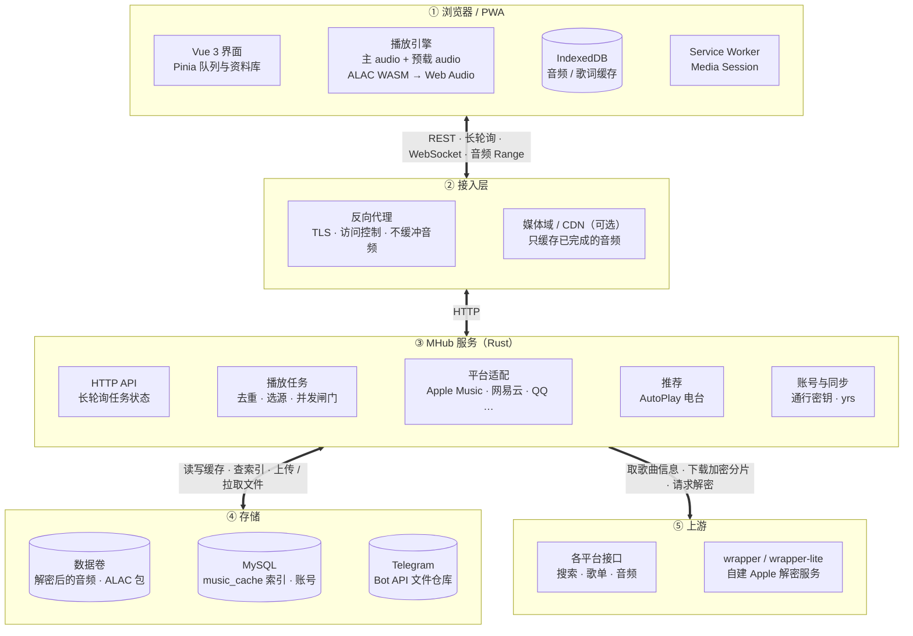
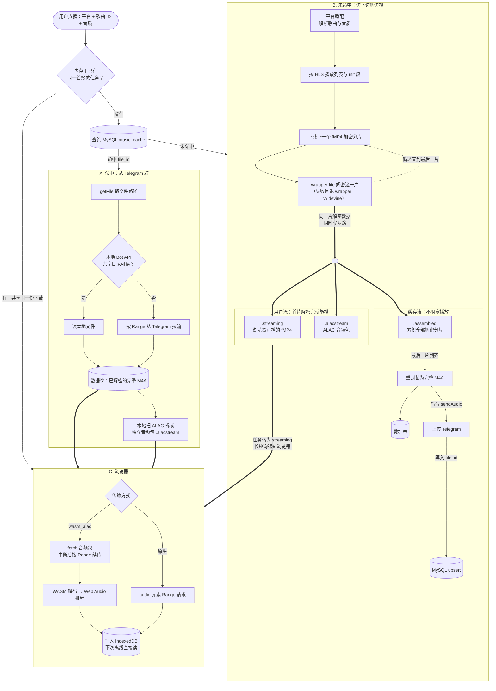

# 架构

```text
Vue / Pinia
  ├─ 搜索、推荐、歌单和播放队列
  ├─ IndexedDB 音频与歌词缓存
  └─ 播放器
       ├─ 浏览器原生音频
       └─ WASM ALAC 解码 → 按帧排程的 AudioBuffer 播放
                    │
              Rust / Axum
       ┌────────────┼──────────────┐
    平台适配      播放任务        缓存协调
       │            │              │
 外部平台/wrapper   文件/包流    本地磁盘 / 可选 MySQL + Telegram
```

## 架构图

### 部署层级



### 一首歌的数据流



命中缓存时，Telegram 里存的就是解密后的完整文件，不再经过 wrapper；未命中时，每解密一片就同时写给用户和缓存，首片到手就能开播，Telegram 上传在整首下载完后后台进行，不占播放的时间。模块边界和账号同步的细节见本页[边界与数据流](#边界与数据流)。

## 边界与数据流

`src/api.rs` 提供界面所需的 HTTP 接口和播放任务状态，平台逻辑位于 `src/music/`。音频表示、响度分析、ALAC 包流和缓存分别在独立模块中维护。用户点击播放后先确定当前音质，再选择可复用缓存或准备平台音频；下载过程与界面播放状态独立推进。

ALAC 解码器只把完整数据包解码为 PCM，不处理账号、网络或媒体授权。前端根据浏览器能力选择 WASM 或原生路径，使用流身份与版本校验避免拼接不同文件。原生兼容路径可能需要等待完整文件；不能保证所有浏览器冷缓存都立即出声。

播放任务状态支持长轮询：`GET /api/v1/playbacks/:id?since=<已知状态>&wait_ms=<毫秒>` 会在任务离开该状态时立即返回（最长 15 秒），客户端不再以固定间隔轮询。前端构建时生成 `.br` / `.gz` 静态文件，由后端直接按 `Accept-Encoding` 提供；JSON 接口响应按需压缩，音频与 ALAC 包流不压缩。ALAC 解码器与 AMLL 歌词渲染均为按需加载的独立分块。

浏览器本地缓存按歌曲、音质和音频表示区分，歌词原文跨音质复用；当前曲目完整缓存后才请求下一首。服务器维护本地文件与任务，并可复用已有 Telegram 缓存记录；持久化状态放在数据目录，凭据通过独立配置读取。

### 音源网关

`crates/music-gateway` 是 MHub 与其他服务（目前是 Telegram bot）之间的契约：平台、音质、搜索结果、歌词、曲目元数据、媒体任务与错误码，以及 `client` 特性下的 HTTP 客户端。MHub 的平台枚举与搜索结果类型直接来自该 crate，两端编译期共享同一份定义，`PROTOCOL_VERSION` 不一致时网关拒绝请求。

网关（`src/api/gateway.rs`）只监听 `[gateway] listen` 配置的回环地址，按 Bearer 令牌鉴权。媒体请求先用 `/v1/media/lookup` 判断是否已在 Telegram 缓存（不触发下载），需要下载时 `/v1/media` 复用网页的 `start_download`、inflight 去重与后台上传，`GET /v1/media/:id` 长轮询下载字节进度、上传阶段，直到返回 `file_id`；上传失败时从本地副本重试一次，副本已清理则让任务失败、下次请求重新下载。客户端发现 `file_id` 被 Telegram 拒绝时调用 `/v1/cache/invalidate`。MHub 因此是平台账号、下载和 `music_cache` 的唯一使用方与写入方，客户端只负责自己的用户限流和发送。

## 授权曲库

可选的 `src/library/` 与现有平台接口一起运行于 `music-api`，由 `[library] config_file` 指向仓库外的私有 JSON。空值不注册路由；无效配置或清单使启动失败。页面 `/library/` 由前端构建生成，使用实际 MHub 播放器。浏览器只访问同源接口，不接收 Navidrome 凭据。

独立公开曲库可同时设置 `[library] exclusive = true`。此时只注册 `/api/v1/library/`、`/health`，并在启用页面服务时注册 `/library/`、`/source.tar.gz` 和根路径到曲库的跳转。旧平台、共享播放、原账号与同步路由不注册；静态目录仅限 `web/library`，没有整个 `web` 的回退。该模式不加全局宽松 CORS，响应禁止其他页面嵌入。缺少 `config_file` 时启动失败；默认 `exclusive = false` 保留原综合站点行为。独立回环网关的配置及访问控制仍须单独管理。

显式 `MUSIC_API_CONFIG` 文件不可读取时拒绝启动；主配置顶层和曲库段拒绝未知字段，避免拼写错误静默切回综合站点。仅当未显式指定路径且默认开发配置文件不存在时，允许使用默认配置。错误日志不回显配置内容。

私有配置示意，三个路径均须放在公开源码、Docker 构建上下文和 `web/` 之外：

```json
{
  "origin": "http://127.0.0.1:8000",
  "source": {
    "instanceId": "my-library-stable-id",
    "baseUrl": "http://127.0.0.1:4533",
    "auth": { "username": "service-account", "salt": "<subsonicSalt>", "token": "<subsonicToken>" }
  },
  "policyFile": "/absolute/private/policy.json",
  "cacheDir": "/absolute/private/original-cache",
  "cacheMaxBytes": 134217728,
  "sessionTtlSeconds": 3600,
  "taskTtlSeconds": 900
}
```

`origin`、`baseUrl` 只接受没有路径、查询参数或用户信息的 HTTP(S) origin；非字面 IP 回环地址必须使用 HTTPS。本机曲库直连，不经系统代理；远程 HTTPS 仍使用系统网络配置。禁止跟随重定向。这里使用 Navidrome 的原生 `/auth/login` 验证身份，不等同于支持所有 OpenSubsonic 实现。专用服务账号应为非管理员，将登录响应中的 `subsonicSalt`、`subsonicToken` 放入私有配置；不要放入前端或请求 URL。

清单形如 `{ "instanceId": "my-library-stable-id", "tracks": [...] }`。每项包含 `songId`、`title`、`artist`、`duration`（毫秒）、`format`（`mp3` / `flac`）、`contentType`、`size`、原文件小写十六进制 `sha256`、RFC3339 `modifiedAt`、`access`（`public` / `restricted`）和 `allowedUserIds`（Navidrome 用户 ID）。从已获授权的原始文件计算字节数与哈希，再核对上游歌曲 ID；不能用歌曲名推断文件身份。清单修改后在后续请求重新读取，建议使用原子替换。

| 接口（前缀 `/api/v1/library`） | 行为 |
| --- | --- |
| `GET /session` | 当前曲库身份 |
| `POST /session` | 验证 Navidrome 账号，建立独立会话 |
| `DELETE /session` | 撤销会话和其受限播放任务 |
| `GET /search?q=...` | 上游搜索结果与本地可见清单的交集 |
| `POST /tasks` | 以 `{instanceId, songId, version}` 创建随机 ID 任务 |
| `GET /tasks/:id`、`DELETE /tasks/:id` | 重新授权后查询或取消任务 |
| `GET /tasks/:id/audio`、`HEAD /tasks/:id/audio` | 授权后处理完整文件、单段 Range 与条件请求 |

会话使用随机令牌，服务端仅以其 SHA-256 索引。HTTPS 使用 `__Host-mhub_library_session; Secure; HttpOnly; SameSite=Strict; Path=/`，不设置 Domain；浏览器会拒绝其他子域写入的同名父域 Cookie。回环 HTTP 开发保留 `mhub_library_session; HttpOnly; SameSite=Strict; Path=/api/v1/library`，HTTPS 服务不接受这个旧名字。相同会话名字出现多次时不选择其中一项，而是视为无有效会话。HTTPS Cookie 因前缀要求覆盖整个主机路径，因此页面与源码请求也可能携带 Cookie，外层缓存策略会对这些请求使用 `no-store`。

写操作要求匹配的 Origin 和 `x-mhub-library: 1`；所有曲库接口请求校验实际 Host、Origin 与 Fetch Metadata。`same-site` 不等于 `same-origin`，兄弟子域请求同样被拒绝；`Forwarded`、`X-Forwarded-Host` 等头不能替代配置中的来源。反向代理必须保留外部 Host 的非默认端口。曲库会话与原有 `mhub_session` 及通行密钥资料库互不替代，退出曲库会话不代表退出原有资料库账号。

受限任务绑定创建它的会话。每次任务或媒体访问先检查当前清单、会话和任务归属，再以正确上游身份请求 `getSong`，最后再次检查本地授权。权限在上游等待期间改变时不能混用服务账号和用户账号的检查结果。OpenSubsonic 的 HTTP 200 仍需检查响应体 `status`；认证失败 JSON 不能当作音频缓存。搜索同样在响应返回后重新过滤可见范围。

文件身份为 `instanceId + songId + SHA-256 + raw`，字节副本可共用，授权独立进行；原有全局平台任务、数据库与 Telegram 缓存不参与此流程。下载先写随机 `.partial`，核对大小与 SHA-256、同步文件内容后原子改名；重复创建任务或服务重启后的缓存命中也会校验完整哈希。会话仅在内存中，重启后旧 Cookie 失效，重新登录的合法用户可复用磁盘文件。退出取消该会话的任务，无剩余使用者时取消下载。私有响应还持有会话取消令牌的子令牌；即使旧任务记录已经回收，退出仍能中断该响应。

每个实例使用独占缓存目录。进程先取得 `.mhub-library.lock` 的 OS 文件锁，再删除命名规则匹配的普通半成品文件；进程崩溃后锁由 OS 释放，遗留锁文件本身不会阻止重启。新版本不能让两个进程管理同一目录；升级时应先停止未实现此锁的旧进程。未知文件、目录和符号链接保留，不递归删除。

`cacheMaxBytes` 可选，默认 128 MiB，限制本模块管理的完成文件与并发下载预留总量。下载在请求源端媒体之前预留完整长度；失败或取消在关闭文件、清理半成品后释放预留，发布时在同一锁内将预留转换为完成文件占用。实际磁盘分配块、锁文件和无关文件不在该逻辑字节预算内。清理先回收不再属于清单的闲置版本，再按最近使用顺序回收无任务占用的文件；重启后使用文件修改时间作为初始排序。

正在准备/有效的就绪任务、下载和打开的响应保护其文件。媒体保护随响应体生存，即使客户端暂停读取也不提前释放。清单换版使旧任务失效并取消旧下载，但已经获准的响应保持原版本字节直到结束；旧响应结束后才回收它保护的文件。空间不足且没有可安全回收项时，任务以 `cache_capacity` 失败，不挤掉正在使用的文件；调用方稍后重新创建任务。定时维护约每 5 秒运行一次，无效清单会阻止访问并暂停回收，不将解析失败解释为“删除全部”。

ETag、Last-Modified、Range、304、412、416 与 HEAD 均在授权之后处理。所有曲库响应 `no-store`，外层媒体中间件可能附加 `no-transform`。公开曲目的浏览器离线副本只由显式保存产生，受限曲目不写 IndexedDB；已经交付的字节不能远程回收。已就绪文件每次新媒体访问检查长度，信任由服务端独占的缓存目录；运行期间同长度的外部篡改不在每个 Range 上重新全量哈希。

当前上限为每文件 32 MiB、100 首、有效清单总大小 128 MiB、2 个并发文件准备任务、64 个会话和 256 个任务记录。准备包含缓存校验和原下载，同一个表示的并发使用者合并。记录满时优先回收取消/失败的终态记录；活跃准备/就绪任务不因名额压力被删除。查询已回收的终态 ID 返回 404。媒体响应另有 32 路上限，达到时返回 `429/media_limit`；同一任务的多个 Range 分别计数，HEAD 和无正文条件响应不占流名额。这些是资源预算，不是并发用户容量。

`preparation.rs` 管理最多 16 个等待表示和每个用户最多 4 个等待表示。使用已认证的稳定上游用户 ID 分组，同一用户的多个会话合并计额；匿名请求共用一组。按组轮转，组内先进先出；正在运行的工作不被抢占。新表示始终入队，不能跳过旧等待者直接抢准备名额。合并请求保持首次入队者的组和原始期限，后来的使用者不重设期限或再占位置。

排队返回 `202/state=preparing`；队列满或用户等待位置满分别返回 `429/preparation_queue_full`、`429/preparation_user_limit`。单调时钟限制等待为 5 秒，超时的所有使用者变为 `failed/preparation_timeout`。取消最后一个等待者立即删除该工作；正在运行的工作在实际文件清理结束后才归还准备名额。内部代际 ID 防止旧完成事件移除相同表示的新工作。

等待阶段不打开缓存文件、不发起媒体下载、不预留磁盘。轮到后从尚有效的使用者选择身份，再检查当前清单、会话和上游 `getSong`，检查前后保持权限一致。首位使用者失效时可换另一位合法使用者；每位使用者的任务和媒体访问仍独立授权。缓存准备的再次授权与原下载都受两路准备名额约束。这里的公平性针对等待调度，不承诺抢占已在运行的慢下载，也不提供多实例间的全局公平性。

源端 `getSong` 的 HTTP 200／Subsonic 错误 70 可能表示当前账号看不到该歌曲，不能据此判断所有共同等待者都无法访问。调度前再次授权若得到 `401`、`403` 或源端专用的 `404/source_missing`，只终结该使用者的任务，再尝试另一位仍有效使用者的真实身份；全部身份失效时不进入文件下载。普通本地 `404/track_missing` 不走此分支。这处理的是调度前资格检查，不声称覆盖下载过程中所有撤权竞态；媒体请求仍单独检查权限。

会话默认 1 小时、任务默认 15 分钟，分别可用私有 `sessionTtlSeconds`（1..3600）和 `taskTtlSeconds`（1..900）缩短；私有 JSON 拒绝未知字段和无效值。受限任务不晚于其会话到期。周期清理不依赖新的 HTTP 请求，约每 5 秒撤销会话、取消任务并回收记录。完整缓存可以保留以供重新授权后复用，终止授权不等于删除共享字节副本。

`music-api` 的 `exclusive` 主入口使用 HTTP/1，最多接受 128 个连接，请求头期限 10 秒、无收发期限 30 秒、连续写阻塞期限 15 秒。退出、显式取消及自然过期会从连接外部唤醒并关闭正在背压的响应；只在 Body 下一次 poll 检查取消令牌不够。关闭连接会释放该响应的文件和名额，已进入 TCP/客户端缓冲区的字节仍可能被客户端取出。清单换版不主动关闭已获准的旧响应，其原始期限与会话撤销仍然有效。正常完成/断连会取消每条响应的后台监听。

上述背压连接保证由独立曲库主入口提供；直接把 Router 嵌入其他服务器或使用综合站点时，应实现同等连接取消和超时，不能沿用该入口的实测结论。综合站点与独立网关保留原有服务器。HTTP/2 可在 TLS 边缘终止，但对该独立入口使用 HTTP/1 回源。

首次播放等待完整文件；源请求总超时 20 秒；暂不支持子路径 Navidrome、ALAC、持久会话、多实例任务或受限离线授权。文件换版仍需可信原件计算的新 SHA-256 与清单更新，不自动探测任意同长度上游修改。进程终止恢复不等于已验证断电、损坏的磁盘硬件或网络文件系统。诊断计数仅在显式设置 `MUSIC_API_LIBRARY_METRICS_FILE` 时写到私有文件，无公开诊断接口；包括任务、会话、准备作业、响应及文件计数，不参与授权判断。

### 独立曲库离线页面

独立曲库页面通过 `scripts/library-lab/queue.mjs` 复用现有播放器队列。第一次选曲建立当前结果的顺序快照；后续搜索只改变结果列表，上下首与自然续播依据队列。“追加”“替换并播放”“下一首播放”分别保留现有队列、替换为当前结果、将曲目移动到当前曲目之后；重复追加不制造重复项。“移除”和“清除待播”保留当前音源。

独立页面的队列与播放偏好只在页面内存中使用，不写入综合站点的队列或状态localStorage；刷新、登录切换和退出时清空。断网后保留已在播的公开Blob，并移除没有公开离线副本的待播项。播放源准备期间主按钮显示暂停，用户暂停会取消该播放准备请求与播放器待完成的启动；不会取消独立的用户保存操作。桌面自然EOF续播沿用主播放器事件与旧音源保护，手机锁屏和系统媒体归属需真机另验。

曲库浏览从当前授权的目录响应派生。关键词同时匹配歌名、歌手和专辑，支持大小写、全角和拉丁重音归一化；中文输入法组合期间不处理尚未完成的文字。专辑名称、格式与“仅已保存”条件取交集，后者使用实例/曲目/原件版本完整缓存键。排序可以保留曲库顺序或按曲名、歌手、专辑曲序、时长稳定排列；未知曲序和时长排在已知值之后。浏览条件只改变结果，不直接改变播放队列或权限。

页面每批显示24项，“显示更多”追加下一批；播放和追加当前结果仍使用完整筛选后的列表。目录和专辑选项仅在内存保存，身份切换立即清空；旧请求会取消，迟到的响应由身份与请求代数拒绝。只将排序枚举持久化到独立键，不保存关键词、专辑名或账号目录。断网使用已保存公开曲目作为浏览来源，恢复联网重新读取授权目录。该目录沿用后端现有100曲策略上限，本轮分批渲染不是后端分页或大规模曲库支持。

结果与离线列表按实例、曲目、原件版本复用仍在本区域内的行。存储同步和重新读取目录只更新变化的文字、封面及保存状态，不整批替换未变化的原生控件；相同表示的菜单展开状态、键盘焦点和已有批次保留。同版本元数据更新后，按钮读取该行当前数据，已排好的播放队列仍是原快照；原件换版或身份失效会删除旧行及菜单，不能复用另一版本的动作。此复用只在当前页面DOM与WeakMap中，无持久化目录。

列表更新导致当前控件消失时，焦点转到同一行可用动作、相邻仍可用的行或该区域标题；移除操作结束后再次核对动作是否解除等待。异步结束时若用户已将焦点移到其他控件，则不抢回焦点。恢复焦点之后依据固定播放栏实际高度调整滚动，搜索输入、过滤器等列表之外的焦点保持原处。列表同步本身不改变播放队列或原生音源；原件/授权、断网与存储失败仍由已有独立逻辑处理。

构建同时生成 `/library/sw.js`、带内容哈希的安装清单和192/512像素图标。Worker仅控制 `/library/`，与综合站点的根Service Worker和安装身份分开。安装时以不带凭据的请求读取预先列出的HTML、播放器、清单和图标，逐项校验长度及SHA256；只保存该静态集合，不缓存任何API、播放任务、账号、音频或源码下载响应。

独立页面的账号状态与曲库读取分别处理。会话验证成功后，即使后续目录请求失败，也保留已确认身份，错误只显示在目录区域，不作为登录失败；目录重试不重新提交凭据。会话请求超时、网络或格式异常时显示“账号状态未确认”，清除受限音源和旧授权目录，提供重新确认入口，已保存公开副本独立保留。用户登录提交或退出请求的确认可能丢失而服务器已经处理，所以失败不意味着服务器会话一定未改变；本页与同源标签页需要重新读取实际会话，不自动重发登录凭据。新的确认代数与取消信号拒绝旧响应覆盖当前身份；人工重试恢复网络时保留已附着且校验过的公开Blob。

`scripts/library-lab/request.mjs` 为会话、目录和任务等JSON控制请求设置25秒总期限，覆盖响应头和完整响应正文；限制为1MiB，验证JSON媒体类型与UTF-8/JSON对象，不把代理HTML内容显示为错误文字。取消、超时、网络故障和结构化HTTP错误分别处理；调用方取消不会自动转为离线或重新请求。该期限独立于音频正文、服务器20秒源请求及任务准备总期限，不承诺永久不可用网络可自动恢复。请求失败后的重试由用户发起；取消未知ID的任务或已经送达的会话变更仍依赖服务器生命周期。

公开音频仍由用户显式保存到既有IndexedDB，保存和再次离线播放均校验原件版本。断网重新打开时从已知实例的公开副本建立本地曲目列表，不恢复在线身份、私有队列或登录结果。已在播放的公开Blob可继续；受限源遇到断网会取消并分离。恢复联网后重新读取会话和当前授权。

离线操作以实例/曲目/原件版本为键，通过 `operations.mjs` 合并同一页面的重复保存，并用同源Web Locks顺序执行合作标签页的保存和移除。获得锁后再次核验已有副本，两个页面不会重复下载完整原件；不支持Web Locks的浏览器仅有页面内协调。保存期间所有匹配按钮保持等待状态，即使列表重绘；完成写入后BroadcastChannel只发送实例标识，其他页面重新读取IndexedDB，重新获得焦点时也复核。不会通过广播发送曲目目录、音频或凭据。

`scripts/library-lab/download.mjs` 单独限制显式离线音频下载：可信原件长度须为1字节至32MiB，仅接受对应的`audio/mpeg`或`audio/flac`、HTTP200和匹配的Content-Length（若提供）。流式读取按实际收到的字节报告进度，在保留超长分块之前拒绝，提前EOF也失败。响应头及正文受15秒无字节进展期限和5分钟下载总期限约束；只有非空字节重置空闲期限，持续慢流不能延长总期限。该期限从音频请求开始，不包括此前的任务准备，也不包括随后SHA256和数据库写入。异常会中止请求、取消读取器并解除等待；每次异步等待结束移除其取消监听，不为每个分块积累未决监听。

“保存进行中”区域独立于搜索结果，显示等待其他页面、检查已有副本、准备、下载、校验、写入和完成等阶段。百分比以收到的字节为准，更新约120毫秒节流；100%只表示字节已下载，仍需完整EOF、原件SHA256和写入成功才能称为已保存。逐首取消只中止该表示的操作，包括尚在等待Web Lock的保存，不影响另一首或其他页面持有的下载。取消完成后将已移除按钮的键盘焦点交还可见的取消控件或离线区域标题。

校验和提交之前取消不留下不完整音频；WebCrypto计算本身不可中止，完成后仍核对取消信号和身份代数以阻止写入。已提交完整音频后取消封面补充或最终元数据写入，会保留并重新读取音频，显示“音频已保存，后续处理已取消”，不会为了取消删除完整副本。此边界也适用于后续处理失败；当前页面须自行刷新，不能依赖不会发回发送者的BroadcastChannel。取消尚未完全收尾时仍计入离线操作，阻止页面更新。

离线存储是独立能力，目录读取与存储读取并行；数据库打不开或读请求失败不阻止在线曲库、登录和在线播放。页面区分“读取中”“可用”“暂时不可用”，读取失败时隐藏尚未复核的副本与“仅已保存”条件，显示可重试的存储提示，不把读取失败描述成没有副本或零占用。重试重新读取原数据库，不清空数据；断网时只能使用校验通过的公开副本，已经附着的公开Blob不因存储读取失败而停止。

共享缓存服务的数据库打开请求和只读事务分别有3秒期限，过期的打开结果若迟到会关闭连接。打开失败不保留被拒绝的Promise；连接发生versionchange/close时释放，创建事务前发现已关闭连接可以重新打开一次。只有尚未提交请求的连接失败会这样重试，写入失败不隐式重放。读超时会中止自己的只读事务，其他写事务与原记录保留。在线音源解析在存储不可用或副本校验失败时向后端重新取源，不自动删除损坏副本；需要用户明确保存才替换它。主题、排序与实例偏好的localStorage读取或写入被拒绝时，在页面内存中继续使用，重开后的离线实例恢复可能不可用。

新下载先检查长度和SHA256，再直接替换同版本的损坏副本。IndexedDB事务捕获异步回调中的同步异常和请求错误，失败会中止事务并解除按钮等待，空间不足给出重试提示。身份变化、断网或离开页面会取消未提交的写入；已经提交的完整公开音频可保留，取消不能回收已提交字节。封面补充失败不会删除已提交音频，也不把失败显示为完整保存成功。

新播放选择取消旧解析请求；已知后端任务在失败、取代或音源释放后尝试DELETE取消。媒体元素仍在使用的任务保留，下载任务不删除磁盘音频缓存。取消请求有2.5秒期限，页面退出和网络故障可能使请求无法抵达；尚未收到任务ID的POST也无法显式撤回，仍依赖服务器任务过期。公开音频Blob URL在异步校验完成且选择仍有效后才创建；源交接有1秒余量，周期检查保留当前与已附着音源，释放废弃URL及追踪记录。URL数量核验不等同于真实内存峰值或长时间设备续播验收。

独立页面将播放器已有的失败和允许播放通知接入播放栏旁的反馈区域，保存当前曲目表示及身份代数。动作返回成功并不等于已经发声：提示结合播放器状态、当前原生元素和其音源判断，相对媒体URL先按页面地址归一；浏览器阻止启动时显示“等待允许播放”，准备/解码失败显示“播放未能开始”及原错误。允许播放重用已附着音源，用户明确重试准备/解码失败时停止旧源后重新解析当前曲目，队列顺序保留，不新增自动重试。主播放按钮使用同样的重试路径；暂停可以取消尚未结束的重试。

反馈不持久化；身份变化、选择其他曲目或当前音源实际进入playing后清除，旧曲目的迟到失败不能覆盖新音源。自动自然续播的准备失败也通过同一通知路径显示；原有播放器的有限媒体错误恢复/跳过策略仍有效。提示和按钮随失败/准备状态一致更新，重试期间disabled/aria-busy；成功隐藏提示时保留可见控制焦点。播放栏高度由ResizeObserver同步给页面底部空间，主控件焦点和窄屏布局按实际高度避让。这只验证页面内反馈，不证明音频输出设备、手机锁屏或系统通知状态。

控制请求保留经过格式验证的错误码、HTTP状态与消息；失败任务也保留协议原因。`playback-recovery.mjs`按协议选择恢复方式，不解析中文错误文本：登录或任务归属/权限错误重新确认当前身份，实例不存在重新连接，原件版本、权限策略或曲目目录变化刷新曲库，临时连接、任务过期和解码错误沿用显式播放重试。HTTP错误码和状态不匹配时采用普通重试，未知原因不猜测授权结果。浏览器媒体错误没有控制接口的结构化正文，仍沿用播放器恢复策略。

身份恢复复用现有会话核对及失效流程，清除页面的旧授权状态并重新读取可访问目录，保留已保存公开副本；完成后焦点指向登录、账号状态或重新确认动作。目录恢复停止失败音源、保留队列，刷新完成仅引导用户从当前版本列表重新选择，不自动替换旧队列或启动音频。刷新失败原因仍显示在播放器旁。重复恢复共享等待，暂停、切歌、身份或页面变化可取消；迟到结果既不能标记新错误已恢复，也不能抢走用户已移动的焦点。目录刷新期间同时阻止页面更新。

显式播放入口通过`play-intent.mjs`记录当前动作。同一表示的曲库、离线列表、队列与主播放入口共享尚未完成的选择，重复动作不取消并重建同一准备请求。完整结果的“替换队列”使用包含有序原件表示的独立动作键，保留替换与选择的区别。换目标会取消旧动作的解析请求；旧完成只能解除自身等待，不能清除新的动作。执行播放器动作保持在点击的同步调用中，不为协调额外延迟原生启动所需的用户激活。

等待覆盖源准备、已保存原件校验和原生play确认，同曲目的所有播放控件统一disabled/aria-busy与“准备中”文字。其他曲目仍可选择，播放器暂停仍可取消当前准备；取消立即释放当前动作，同曲目可重新选择，尚未完成的旧处理仍计入操作数量，阻止Worker激活。自然续播的准备由播放器自身管理，同表示入口在准备时同样禁用且拒绝重复请求。动作完成后恢复发起控件的可见焦点，用户已转去别处时保持新焦点；按钮预留等待文字宽度。底层播放器、音频字节和队列持久化策略仍使用已有独立规则。

队列视图按实例、歌曲与原件版本复用曲目行和原生按钮，状态更新只改变化的文字；重排移动已有行，移除丢弃对应控件。行内动作按当前队列中的表示查找目标，已删除行的迟到回调不按旧下标操作其他歌曲。删除后的焦点优先同曲目可用动作、随后相邻动作，空队列回到标题；准备中的发起按钮等待自身动作完成，不临时转到另一首。计数使用完整的ARIA状态，正常刷新既不重建列表，也不重复恢复已经保留的焦点或干预用户滚动。

队列渲染按有序原件表示、标题/歌手、当前下标、播放状态、准备动作、身份变化、操作忙碌与结果可用性检查是否变化；普通进度刷新可直接跳过未变化队列。重复设置相同文字、属性、disabled、class及更新按钮状态同样跳过，进度条继续以原频率读取实际媒体时间。该优化不改变音频解析、自然续播、页面隐藏时的原有行为或任务清理；测量需分别记录渲染工作、CPU时间、原生音频前进和资源占用，不能用节点更新减少直接证明内存下降。

独立页的`seek.mjs`将进度条预览与实际跳转分开。没有编辑动作时，即使进度条仍有键盘焦点，也读取当前已附着原生音源的currentTime；匹配音源前、准备或跳转尚未确认时保留播放器的位置，避免共享估算时钟提前于实际媒体。鼠标按下至松开、按住方向键至松键期间只更新预览时间与aria-valuetext，不反复修改原生音频位置。方向键每步5秒，PageUp/PageDown每步10秒，Home/End选择起点或终点；松开一次才提交。保留原生range的点击输入及辅助技术直接input/change入口，不要求拖动才能选择位置；配对事件避免重复提交。

账号操作保留提交时的焦点归属：登录完成后聚焦账号状态，退出后回到账号输入，凭据被拒后回到密码输入，无法确认结果时聚焦重新确认按钮。操作期间若用户主动把焦点移到账号区域外，完成响应不再移回。登录错误通过两个输入的 `aria-describedby` 关联，401 时标记输入无效；账号状态初始读取与其他标签页同步不主动抢焦点。筛选控件使用有名称的 group，曲目时长以实际文本前缀表达，音量提供百分比 `aria-valuetext`。

预览关联当前身份代数、曲目表示与已附着音源。没有音源或音源正在准备时禁用；切歌、身份变化、Escape、失去焦点或捕获取消会丢弃旧预览。丢失鼠标捕获后可能仍有原生input/change，取消状态保持到原手势结束，防止旧位置影响新音源。跳转沿用主播放器seek，暂停状态继续暂停、播放状态按原有意图恢复。仅获得焦点不触发跳转；编辑未结束或原生audio仍在seeking时阻止Worker激活。输入显示预览与总时长，确认后重新跟随播放时钟；原生解码与媒体会话行为仍需各自验证。

新版Worker安装后等待，不自动跳过等待或刷新页面；点击更新时检查所有曲库标签页均无播放、准备或保存操作，才激活，并只刷新发起更新的空闲页面。旧标签页不强制刷新；其页面缓存保留，直到只剩一个新版本窗口时才回收。音频IndexedDB不参与页面缓存回收。浏览器清理站点数据、存储回收或切换主机名/端口仍可能使离线副本不可用；保存的公开副本不等于受限离线授权。

### 原件扫描与封面

`scripts/library-lab/scan_library.py` 使用 FFprobe 读取音频标签与时长，计算原件 SHA256，并用 FFmpeg 将嵌入图片转换为不超过256像素、64KiB的JPEG缩略图。读取前后检查原件状态并再次哈希；扫描期间修改会拒绝生成候选。输出放在原件目录以外，音频不改写。当前曲库可播放MP3/FLAC，其他探测到的格式仅进入清单，不自动改变格式支持。

文件绑定清单负责把相对原件路径对应到现有Navidrome曲目ID，不传授权配置。候选策略保留既有access和allowedUserIds，新增曲目默认restricted且没有授权账号；未绑定旧条目保留，不自动删除或应用清单。inventory记录原件元数据、changes记录版本/标签/封面变化，二者与曲目权限均是实例私有数据。

策略条目可选album、year、trackNumber和artwork描述符；省略时兼容旧策略。配置可选artworkDir，目录存放按封面SHA256命名的JPEG。`/api/v1/library/artwork/:song?instanceId=...&version=...`复用曲目授权，在读取后再次核对会话、策略与封面版本，所有响应no-store。不会将私有目录路径、授权账号名单或上游凭据写入公开DTO。

浏览器仅接受当前实例和原件版本对应的同源封面端点，校验大小、哈希、JPEG解码与尺寸。普通查看的封面仅在内存中；显式保存公开音频时，公开缩略图可伴随音频进入原有IndexedDB条目。受限封面不持久化；账号/网络变更取消请求并撤销URL。Worker仍只缓存五个静态资源，不缓存封面API。缺失、损坏或超时的封面回退占位，播放准备最多短暂等候封面，不等待整个封面网络请求。

## 可维护性

- Rust 和 npm lockfile 固定依赖；Docker 重新构建解码器与前端。
- 默认测试使用合成数据或本地 mock，真实账号下载显式 opt-in。
- 公开源码、Docker 上下文和对应源码包共用发布边界检查。
- API 运行能力保留；历史在线 API 文档、部署记录和私人数据不随源码发布。
- 旧平台配置、音频缓存和播放任务仍由所有访问者共享；原有账号只隔离个人资料库与接力播放状态。授权曲库的独立会话与媒体检查仅覆盖 `/api/v1/library/`。

## PWA 安装与更新

安装清单的 `id`、`start_url`、`scope` 保持稳定；明暗主题清单共用身份。图标使用内容哈希 URL，安装元数据按发布版本更新并重新验证 HTTP 缓存，离线仍可使用缓存副本。Service Worker 更新绕过脚本 HTTP 缓存；更新不会强制刷新正在播放的页面，也不会清理音频缓存。

`frontend/public/icons/app-icon.svg` 是安装图标的源文件。可选开发工具 `scripts/generate_pwa_icons.mjs` 使用 Sharp 生成 192／512 像素全彩 PNG、Apple Touch 图标和内嵌 PNG 的 favicon.ico，Sharp 不进入前端运行包。生成时设置 `SHARP_MODULE` 指向本地安装的 Sharp 模块入口；更换图标后提交生成资产并执行 `node scripts/verify_pwa_icons_browser.mjs`（可通过 `PLAYWRIGHT_MODULE` 指定 Playwright 模块）。

部分 Android 浏览器将重新编码的图标写入快捷方式字符串，受系统 65,535 字节限制；下载 PNG 的体积无法预测此字符串大小。浏览器验证覆盖多种缩放尺寸和 PNG 再编码，发布验证还需检查真实设备的快捷方式能否持久化。图标采用低复杂度矢量源，避免噪点纹理放大重新编码体积。

## 账号与跨设备同步

`[auth]` 的 `rp_origin` 为空时账号功能关闭，`/api/v1/auth/config` 返回 `enabled: false`，前端不显示入口，也不加载同步代码。启用后需要 MySQL；账号相关表（`mhub_` 前缀）由服务启动后首次使用时 `CREATE TABLE IF NOT EXISTS` 创建。

- **认证**（`src/accounts/`）：通行密钥（webauthn-rs，可发现凭据）为主，argon2 密码兜底，注册时生成 8 个一次性恢复码。会话令牌放在 `HttpOnly; SameSite=Lax` Cookie `mhub_session`，库中只存 SHA-256；30 天滑动续期，可在设备列表吊销。写操作要求 `x-mhub-client` 头，WebSocket 握手校验 Origin。注册可选 Cloudflare Turnstile；登录与注册按 IP 和用户名限流。
- **资料库**：每个账号一份 Yjs 文档，包含歌单（含有序曲目键）、曲目元数据、喜欢／少推荐。曲目键为平台加源 ID，不含音质。服务端以 `yrs` 持有内存文档，更新追加写入 `mhub_library_updates`，每 200 条或 1 MB 压缩为快照；同一账号的连接通过广播互推。单次更新上限 2 MiB，单文档上限由 `library_limit_bytes` 配置。
- **传输**：`/api/v1/sync/ws` 使用 y-sync 协议（step1/step2/update）；无法建立 WebSocket 时退回 `POST /api/v1/sync/library` 交换状态向量和差量。
- **本地副本**：登录后的资料库保存在 IndexedDB（`mhub-library-<账号 ID>`），同步代码为懒加载分块。会话过期或断网时继续写入本地副本，重新登录同一账号后由 CRDT 自动合并，新增、改名、删除与重排都不会重复或丢失。
- **登录合并**：同一账号的副本直接走 CRDT 同步；另一账号的副本保留在本机，切换到新账号；游客 localStorage 数据生成合并预览——规范化同名且曲目重合度不低于 60%、或来源链接相同的歌单合并，其余新建，喜欢／少推荐取并集。处理过的游客歌单打 `importedTo` 标记，不会重复询问。主动退出登录时可选择清除本机云端副本。
- **接力播放**：播放队列不进入 CRDT。每台设备上报最近一份播放快照（队列窗口、位置、播放模式），服务端按设备后写覆盖并推送。其他设备在首页和队列页显示“在此设备继续”，用本机音质设置接管，不会打断本机播放。

**导入歌单同步**（`frontend/src/services/playlist-sync.js`）：同平台导入（来源平台与播放平台相同）会保存原歌单链接、来源平台和导入时的来源曲目快照（`source_keys`）。同步时重新解析原歌单，按「上次快照、原歌单现状、本地歌单」三方合并：原歌单新增的歌插入到原歌单相邻歌曲之后，原歌单删除的歌在本地删除，用户在本地自行添加或删除的歌保持不变。打开应用时，超过 24 小时未同步的歌单会在后台逐个同步；歌单详情页和歌单右键菜单可随时手动同步。登录后同步以最小增删操作写入 Yjs 资料库，与其他设备的并发修改正常合并。跨平台导入依赖模糊匹配，不参与同步。

`scripts/verify_account_sync_browser.mjs` 用两个浏览器上下文和虚拟认证器验证游客合并、通行密钥登录、实时同步、会话失效后的离线合并及接力播放；需要启用 `[auth]` 的后端和测试数据库。
